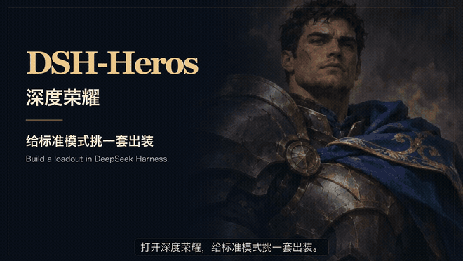

# DSH-Heros

[简体中文](README.zh.md) · [Download the plugin](https://github.com/pearjelly/dsh-heros/releases/latest) · [MIT License](LICENSE)

Choose a hero, equip real tools and plugins, and take that loadout into a DeepSeek Harness session.

| [Introduction · 21 sec](https://github.com/pearjelly/dsh-heros/releases/download/v0.67.1/dsh-heros-promo-standard-narrated-zh.mp4) | [Installation and Standard Mode walkthrough · 1 min 42 sec](https://github.com/pearjelly/dsh-heros/releases/download/v0.67.1/dsh-heros-standard-guide-intro-zh.mp4) |
| --- | --- |
| <a href="https://github.com/pearjelly/dsh-heros/releases/download/v0.67.1/dsh-heros-promo-standard-narrated-zh.mp4"></a> | <a href="https://github.com/pearjelly/dsh-heros/releases/download/v0.67.1/dsh-heros-standard-guide-intro-zh.mp4"></a> |

Both videos have Mandarin narration and Simplified Chinese captions. The walkthrough opens with the banner unlock, then shows installation, a live Standard Mode combo, and how to continue the same conversation with new gear. [Sample files and first-turn task](docs/demo/lighthouse)

## Install

Requires DeepSeek Harness 0.2.1-rc.1 through 0.2.1-rc.5, or 0.2.2-rc.1 through 0.2.2-rc.5. Run the command with the CLI for the DSH installation you use.

```sh
dsh plugin --profile web add -w https://github.com/pearjelly/dsh-heros/releases/download/v0.82.0/dsh-heros-bundle.tgz
dsh web
```

For the desktop app, use its bundled CLI with `--profile desktop`, then quit and reopen the app. If an earlier copy is installed, remove `dsh-agent-loadout` from the same profile before installing the release. The package keeps that identifier for compatibility.

Open **DSH-Heros** in the sidebar. It follows **Settings → General → Language**. Select 中文 to use **深度荣耀**. Third-party plugin text and your own labels remain in their original language when there is no translation.

## Play your first rematch

1. Open **Lighthouse Supply Run** in the lobby and choose **Lighthouse rematch lesson**, then **Start rematch lesson**. The lesson prepares the sample files and a Standard Mode loadout for direct delivery. You can start without setting up a workspace or saving a plan.
2. In the new DSH session, review and manually send the prepared task. Open the delivered lighthouse card, then choose **View lesson results** from the session to check the verified result.
3. Choose **Try one gear change** and preview **Delivery Review**, shown as the **Lesson suggestion**. Open the rematch in its own DSH session and send the same task yourself. When the DSH question card appears, confirm delivery or request changes. Reopen the comparison to check the recorded choice and any delivered file.

**Lighthouse Supply Run** also offers the original **Recon** and **Delivery** routes.

## Use the lesson loadout on your own task

1. Choose a verified run from the Lighthouse lesson. You can use the original direct delivery loadout or a rematch with Delivery Review. Choose **Use this loadout on my task** from the lesson or **Run history**. Saving a plan is optional.
2. Choose one of your existing workspaces, use **Browse files** to pick your own material, and fill in **New task brief**. Choose **Review file and loadout** to check the preset, equipment sources, and prepared task, then choose **Confirm and open session**.
3. Check the task in the DSH input box and send it yourself. With Delivery Review, answer the new session's question card to confirm delivery or request changes, then open any file actually delivered for this task.

## Try one gear change

1. On a completed, verified side of a workspace or saved plan comparison, choose **Try one gear change**. Add, remove, or swap one piece of gear and preview the resulting capabilities and sources.
2. Keep the same material and task. Open a fresh DSH session, review the prepared task, and send it yourself. If the material has changed, start a new comparison to establish a baseline.
3. Open the two source sessions to check the actual tool calls, recorded choices, and delivered files. Add **Delivery Review** to a direct delivery loadout to see whether the new session asks you to confirm delivery or request changes.
4. When the rematch is verified, choose **Try one gear change** on that run to use it as the next baseline. Choose **View previous comparison** to follow the changes one run at a time. From **Run history**, revisit any verified run, review its loadout, and save it as a plan.

## Compare your saved loadouts

1. In **Loadout plans**, select a plan and choose **Compare with another saved plan**. Select a different plan, choose one workspace, and use **Browse files** to pick the shared material. Enter the task for both plans.
2. Choose **Review both plans** to check capability changes, tool sources, and whether both loadouts are ready to run. Open each loadout in its own DSH session and manually send the same prepared task in both.
3. Compare the actual tool calls, choices recorded in DSH question cards, and delivered files. Open either original session to check its results. Return through **Run history** to find the comparison and keep the loadout you verified.

## Use saved gear for a new task

1. In **Loadout plans**, select a plan and choose **Start a task with this loadout**. Choose an existing workspace and use **Browse files** to select material. You can search by file name or relative path, including names with spaces or Chinese characters. Picking another file keeps the task description you entered.
2. Choose **Review file and loadout** to check the preset and the equipment sources available now. Choose **Confirm and open session** to open a fresh DSH session. Review the prepared task in the conversation and send it yourself.
3. With a review-first loadout, check the draft and answer the DSH question card when it asks whether to confirm delivery or request changes. Open the actual attachment from that session after it is delivered.

## Find a run worth keeping

Open **Run history** in the lobby. Search by task, workspace, or material to find a previous comparison or rematch. Filter for delivered files or recorded choices. Follow the source sessions to open attachments and read the original DSH question cards.

Choose **Review and reuse loadout** for the route you want to keep. For a review route, you can check the recorded decision before reusing its gear. Choose **Save as plan** and enter a name you can find again.

## Compare delivery playbooks on your own material

1. Open **Compare in workspace** in the lobby. Choose an existing workspace and use **Browse files** to select the material for both routes. Start **Deliver directly** and **Review before delivery** in separate Standard Mode sessions in that workspace.
2. Review and manually send the same prepared task in each session. The review route can show a draft and ask for confirmation or revisions. Answer the question card in its source session.
3. Return to the comparison to check any pending question, your recorded answer, actual tool calls, and delivered file names. Open either source session to inspect the result. Use **Review proven loadout** to reuse the gear from a completed round.

If the selected file changes, start a new comparison with the current version. Earlier verified results stay available from their source sessions.

## Compare two Lighthouse loadouts

1. Choose **Compare runs** in the lobby to open **Lighthouse comparison**. Start **Recon** and **Delivery** in separate, fresh Standard Mode sessions seeded with matching copies of the sample files.
2. Send the same prepared task yourself in each session. Recon can find the card with `glob` and ask whether the path is enough. Delivery equips Deliverable Preview and can attach the card with `present`. Open the original session to inspect the attachment when it is delivered.
3. Choose **Compare runs** in either session to finish the other route or review both results. Compare actual tool calls, any answer you gave in a DSH question card, and delivered file names. Use **Review proven loadout** in the original session to reuse the gear you verified.

## Play the Lighthouse Supply Run

1. Open **Lighthouse Supply Run** in the DSH-Heros lobby. Pick **Recon** to find and report the file path with `glob`, or **Delivery** to use `glob → present` and bring the card into the conversation.
2. Lock in to start a Standard Mode session in a separate sample workspace. Choose **Open first-turn task**, review the task, and send it.
3. On the Delivery route, open `02-lighthouse.md` in the conversation to check the card. When both tools succeed in the same turn for the first time, review the result and claim the combo banner.

For your own tasks, try gear in the armory, compare the capabilities, and start a session in your workspace. To change gear during a task, choose **Return to lobby** and then **Lock in & continue**. Installed presets and tools appear as DSH discovers them. Tools with multiple sources retain the chosen provider. [Plugin guide](agent-loadout/README.md) · [Product roadmap (Chinese)](docs/roadmap.md)

## Use a playbook in your workspace

Open **Playbooks** in the lobby. Both **Direct delivery** and **Review before delivery** use Standard Mode and Deliverable Preview. Direct delivery suits a file that is ready to inspect. For work with a distinct handoff, the review playbook prompts the model to show a draft first and ask whether to hand it over or revise it.

Preview what changes in your current loadout, then adopt the playbook to update the lobby draft. Your workspace and choice to start or continue carry through. The loadout takes effect when you lock it in. Save a playbook you use often as a build plan.

## Share a loadout

Open **Loadout plans**, select a plan, and choose **Share plan** to copy its code. The code carries the plan name, the preset and gear sources, removals, and required package versions. Private settings and the plan note stay in your profile. Loadouts with local files or custom gear that the receiver would need to recreate cannot be exported.

In another profile, open **Loadout plans → Import share code**. Check the preset, equipment, and dependencies before applying. When the original requirements are unmet, choose **Compare local replacements**. Search gear, pick a provider, or leave a slot empty. The review shows interface, dependency, and capability changes. Confirm the adapted loadout to update your lobby draft. You can lock it in or save and share your own plan.

## Reuse gear from a verified result

In the match report or settlement, choose **Review proven loadout**. Check which tools ran successfully, which gear has recorded actions, and which pieces were ready when a combo was accepted. The review lists delivered file names you can look up in the original session.

Select the gear you want to keep and review its original sources and current capability changes. Load it into the lobby for a fresh round, or open the existing **Save as plan** form.

## Develop

```sh
cd agent-loadout
npm test
npm pack --dry-run
```

Tests start DSH with an isolated profile. Set `DSH_LOADOUT_TEST_BINARY` to test a different supported DSH CLI. See the [plugin guide](agent-loadout/README.md) for equipment sources, actions, progression, and package metadata.
