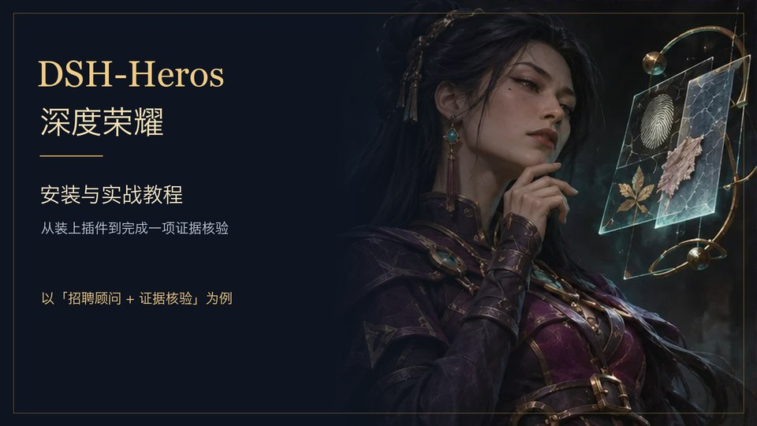

# DSH-Heros

[简体中文](README.zh.md) · [Download the plugin](https://github.com/pearjelly/dsh-heros/releases/latest) · [MIT License](LICENSE)

Choose a hero, equip real tools and plugins, and take that loadout into a DeepSeek Harness session.

| [Introduction · 32 sec](https://github.com/pearjelly/dsh-heros/releases/download/v0.67.1/dsh-heros-promo-zh.mp4) | [Installation and walkthrough · 3 min 13 sec](https://github.com/pearjelly/dsh-heros/releases/download/v0.67.1/dsh-heros-install-guide.mp4) |
| --- | --- |
| <a href="https://github.com/pearjelly/dsh-heros/releases/download/v0.67.1/dsh-heros-promo-zh.mp4"></a> | <a href="https://github.com/pearjelly/dsh-heros/releases/download/v0.67.1/dsh-heros-install-guide.mp4"></a> |

Both videos have Mandarin narration and Simplified Chinese captions. The walkthrough shows a release install, a live **Recruiting Advisor + Evidence Check** session, and the trial reward. To follow along, copy the example into **First-turn task (optional)** in the opening quest. [Fictional recruiting case (Chinese)](docs/demo/recruiting-evidence.zh.txt)

## Install

Requires DeepSeek Harness 0.2.1-rc.1 through 0.2.1-rc.5, or 0.2.2-rc.1 through 0.2.2-rc.2. Run the command with the CLI for the DSH installation you use.

```sh
npm_config_ignore_workspace_root_check=true dsh plugin --profile web add https://github.com/pearjelly/dsh-heros/releases/download/v0.67.1/dsh-heros-bundle.tgz
dsh web
```

For the desktop app, use its bundled CLI with `--profile desktop`, then quit and reopen the app. If an earlier copy is installed, remove `dsh-agent-loadout` from the same profile before installing the release. The package keeps that identifier for compatibility.

Open **DSH-Heros** in the sidebar. It follows **Settings → General → Language**. Select 中文 to use **深度荣耀**. Third-party plugin text and your own labels remain in their original language when there is no translation.

## Try a loadout

1. Choose **Recruiting Advisor** in the hero gallery.
2. Equip **Evidence Check**. Open **Compare loadouts** to see what it adds, then **Lock in & start**.
3. Use **Check key evidence** from **Session gear**. If a material claim lacks a source, DSH can ask whether to gather more evidence, qualify the recommendation, or pause submission.
4. Review the outcome and claim a gear trial. Successful turns and actual tool calls earn XP. Higher levels unlock frames, signature gear, and staged combo challenges.

Installed presets and tools appear as DSH discovers them. Tools with multiple sources retain the chosen provider. The armory can import compatible bundles and configure standalone modules. Levels affect appearance and challenge options.

## Develop

```sh
cd agent-loadout
npm test
npm pack --dry-run
```

Tests start DSH with an isolated profile. Set `DSH_LOADOUT_TEST_BINARY` to test a different supported DSH CLI. See the [plugin guide](agent-loadout/README.md) for equipment sources, actions, progression, and package metadata.
