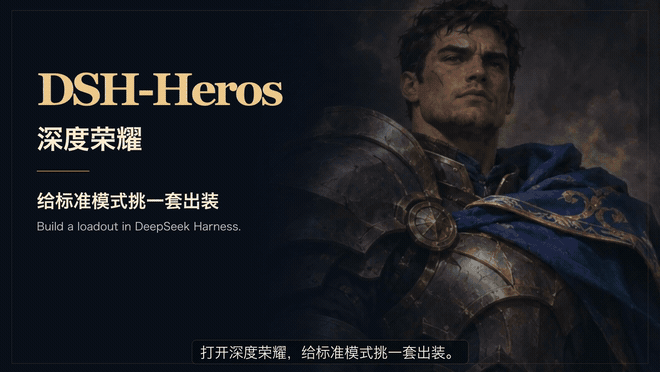

# 深度荣耀

[English](README.md) · [下载安装包](https://github.com/pearjelly/dsh-heros/releases/latest) · [MIT 许可证](LICENSE)

在 DeepSeek Harness 里选英雄、配装备，再用这套阵容开始实际工作。

[](https://github.com/pearjelly/dsh-heros/releases/latest/download/dsh-heros-promo.mp4)

[观看完整视频（MP4）](https://github.com/pearjelly/dsh-heros/releases/latest/download/dsh-heros-promo.mp4)

## 安装

支持 DSH 0.2.1-rc.1 至 0.2.1-rc.5，以及 0.2.2-rc.1 至 0.2.2-rc.2。

```sh
npm_config_ignore_workspace_root_check=true dsh plugin --profile web add https://github.com/pearjelly/dsh-heros/releases/latest/download/dsh-heros-bundle.tgz
dsh web
```

桌面版用应用随附的 CLI，把 `--profile web` 改为 `--profile desktop`，安装后退出并重新打开应用。如果已安装早期版本，先从同一 Profile 移除 `dsh-agent-loadout` 再安装。发布包沿用这个内部名称，便于兼容原有阵容。

从 DSH 侧栏打开 **深度荣耀**。插件跟随 **设置 → 通用设置 → 语言**，选 English 后显示 **DSH-Heros**。第三方插件或用户填写的内容没有译文时会保留原文。

## 试一套出装

1. 在英雄图鉴里选择 **招聘顾问**。
2. 装备 **证据核验**，在 **阵容对照** 查看新增能力，再点 **锁定阵容并开局**。
3. 在 **对局装备** 里打开 **核对关键证据**。关键事实缺少来源时，可在 DSH 提问卡上选择继续补证、降级推荐或暂缓提交。
4. 核对结果并验收装备试炼。成功回合和实际工具调用会结算经验，解锁边框、招牌装备和分阶段连携。

DSH 已注册的预设、工具和插件会进入英雄图鉴或装备库。同一工具有多个来源时，可以指定具体来源。[完整使用说明](agent-loadout/README.md)
